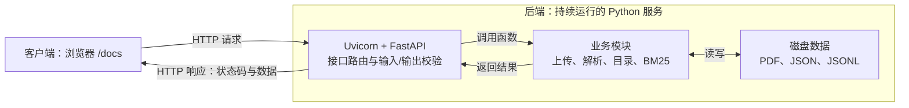

# MathScope 后端 v0.1 里程碑：本地、可评测、可追溯的 PDF 检索原型

整理与验收日期：2026-10-08（Asia/Shanghai）。

版本身份：2026-10-08 初次整理时，Git HEAD 为
`54e4d199db943609ac22ac85cc0fc48fd77ce526`，HTTP 后端与本文尚有未提交改动。
后续增量保留在本文末尾。2026-10-11 的本地版本归档使用 `backend-v0.1` 标签，
可定位包含当前后端代码、147 项测试与依赖快照的提交；不是公网发布或远程备份。
使用 `git rev-parse 'backend-v0.1^{commit}'` 获取该版本的实际提交编号；讲义和解析数据另行备份。

## 1. 一句话定位

已完成：通过本地 HTTP 接口上传 PDF、分配文档编号、按编号提取页面和分块、
按编号进行 BM25 搜索，以及查看文档列表和磁盘处理状态。结果包含物理页号、
原文字符区间与文件指纹，工程行为有自动化测试，检索有固定开发集评测。

尚未完成：完整用户操作页面、可靠的语义/混合检索方案、带引用的生成式问答、
证据不足拒答、研究助手工作流、多用户安全部署和持续性能验证。

当前是“文档检索后端原型”，不是已经完成的学术问答或研究助手；
可以存储多份文档，但一次按编号搜索只检索一份文档。

## 2. 客户端、HTTP、API、后端分别是什么

- 客户端是发起请求、收集用户输入和展示返回结果的程序。目前主要是浏览器中的
  Swagger UI（`/docs`），也可以是直接打开 GET 地址的浏览器或测试程序。
  我们没有手写完整产品前端；FastAPI 根据接口说明生成了现成的测试页面。
- HTTP 是客户端与服务端交换请求/响应的协议，包含方法、目标路径、头部、
  正文和状态码等。它不是搜索算法，也不自动保证检索质量。
- API 是我们约定的可调用能力：例如哪个方法与路径表示搜索、输入什么参数、
  返回哪些字段、什么情况失败。API 不一定必须通过 HTTP；当前项目选择了 HTTP API。
- 后端是接收请求、执行规则与计算、管理数据并返回结果的程序。当前由 Uvicorn
  运行 FastAPI 应用，再调用上传、解析、目录和检索模块，使用本地文件持久化。
- JSON 是大部分请求和响应使用的数据表示格式；PDF 上传则使用 multipart 文件表单。
- 数据库不是后端的必要条件。当前没有数据库，但 PDF、JSON 和 JSONL 已经在磁盘持久化。

客户端和后端现在在同一台电脑上运行。`127.0.0.1:8000` 指向本机服务，
不是一个已部署到公网的网址。停止 Uvicorn 后，客户端无法继续调用这些接口。



例如搜索时，浏览器发送 POST、目标文档编号和查询 JSON；Uvicorn 接收请求，
FastAPI 根据方法与路径找到函数，Pydantic 校验问题、方案和 K；业务模块核对
文件版本与分块来源，建立或复用索引并计算排名；响应模型检查输出，服务返回
HTTP 状态码和 JSON，浏览器把它显示出来。浏览器本身不执行项目中的 Python BM25。

HTTP API 的意义是把“一个只能在 Python 中直接调用的工具”变成“其他程序
也能按稳定约定使用的服务”。以后可以更换网页、增加批量测试客户端或其他界面，
而不把 PDF 解析和排序算法复制到每个客户端。性能、正确性和安全仍取决于后端实现。

## 3. 已完成的能力与目的

### 3.1 页面数据和来源映射

`validation.py` 检查页码，`extraction.py` 按 PDF 物理顺序从 1 编号。
空文本页不被删除，因此后续页号不会因跳过空页而错位。
`storage.py` 使用 UTF-8 JSONL 保存记录；中文、换行和空页经过往返测试。

### 3.2 页内分块

`chunking.py` 将页面原文按字符切成较短片段，默认上限 500 字符、不跨页、无重叠。
每块保留 `start_char` 和 `end_char`，区间为左闭右开 `[start_char,end_char)`。
块文本必须等于页面原文对应切片；位置基于提取后的 Python 字符串，不是 PDF
坐标、印刷页码、词数或大模型 token 数。检索预处理不改这些原始证据文本。

### 3.3 可比较的检索基线

保留最初的子串检索。`tokenization.py` 使用 jieba 搜索分词，
`bm25_retrieval.py` 使用 rank-bm25 评分；原始和术语统一两种方案共享检索实现。
当前术语统一是一个明确、有限的替换规则，不等于通用同义词理解。
仅保留与查询有词语重叠的候选，分数为零或负数不是一概删除的依据。
BM25 分数不是概率、正确率或置信度；没有匹配返回空列表，不等于已经完成拒答判断。

### 3.4 固定开发集和可复现报告

`evaluation_runner.py`、`compare_bm25.py`、`metrics.py` 固定同一数据、题集和 K，
检查 SHA-256、证据位置与摘录，再计算目标覆盖率、目标 MRR 和目标 nDCG。
报告记录数据/代码指纹、运行环境、配置、逐题排名和汇总，并避免覆盖旧报告。
已有逐项比较和诊断记录，不用“看起来更好”替代评测。

### 3.5 HTTP 接口和数据约定

`api.py` 定义路由，`api_models.py` 定义请求/响应模型。
请求模型阻止不合法的问题、方案和 K；响应模型检查字段、类型、范围，过滤未声明字段，
同时生成 `/docs` 中的格式说明。`return` 本来就能返回值，模型增加的是对外合同，
不是让程序第一次能够返回数据。请求错误与服务器输出错误不能混为一谈。

### 3.6 文档生命周期

`document_upload.py` 分配随机编号，用编号而不是客户端文件名构造保存路径，
记录大小和 SHA-256。单文件 10 MiB，检查扩展名与 PDF 文件头；失败时清理本次
创建的不完整文件，同名文档不覆盖已有文件。

`document_processing.py` 按编号核对原文件指纹，复用页面提取、分块和 JSONL 保存，
输出页面、分块和报告。加密或损坏 PDF 会被拒绝，重复解析不覆盖旧结果。
解析在请求内同步完成，当前限制 300 页、提取结果 200 万字符。

`document_search.py` 只检索指定文档，核对上传记录、原文件、解析报告和全部
页号/字符切片；不会用 lecture 基线冒充一个未知或未解析的上传文档。
按“文档编号＋方案”最多缓存 4 套索引，用锁避免同时重复建立，移出缓存不删除磁盘数据。
每次请求仍读文件算指纹；缓存只减少重复分词、数据校验和建立 BM25。

`document_catalog.py` 只读列出文档、分页并推导 uploaded/parsed/incomplete/invalid
状态。单条异常不隐藏其他正常文档，未知信息为 null；目录查询不逐条校验分块。
状态来自磁盘文件，不依赖某次运行的内存缓存，也不修改原上传记录。

## 4. 当前 7 个业务接口

| 方法与路径 | 用途 | 关键边界 |
|---|---|---|
| GET /health | 检查服务运行 | 不是检索质量或生产就绪证明 |
| POST /documents | 上传文件并返回编号 | uploaded 不是解析成功 |
| POST /documents/{document_id}/parse | 按编号解析、分块、保存 | parsed 不代表当前内存索引已建立 |
| POST /documents/{document_id}/search | 单文档 BM25 检索 | 返回证据，不生成答案 |
| GET /documents | 分页列出编号与处理状态 | 默认 20、上限 100，按编号排序 |
| GET /documents/{document_id} | 查询一份文档的信息 | 查看元数据，不是打开原 PDF 阅读 |
| POST /search | 原 lecture 的固定检索基线 | 不自动切换为最新上传的文档 |

`/docs` 和 `/openapi.json` 是自动接口文档，不计入以上业务接口。
Server response 是本次实际结果，Responses 是文档约定；HTTP 200 也可能表示
成功查询到了 invalid 状态，不能将“请求成功”直接等同于“文档处理成功”。

## 5. 数据和内存分别放在哪里

项目根目录：`D:\MathScope项目`。

```text
data/raw/uploads/<document_id>.pdf              原始上传文件
data/raw/uploads/<document_id>.json             上传时的元数据快照
data/parsed/uploads/<document_id>/pages.jsonl   逐页原文
data/parsed/uploads/<document_id>/chunks.jsonl  带编号和来源位置的分块
data/parsed/uploads/<document_id>/parse_report.json  解析报告
reports/evaluation-<run_id>.json                一次评测报告
```

以上原始/解析数据与自动报告目录已被 Git 忽略；版本控制中保留代码、测试和精选说明。
BM25 缓存存放在当前 Python 进程内，不在浏览器里；服务重启后重新建立。

## 6. 验收证据

### 6.1 工程测试

2026-10-08 重新执行，112 项测试、0 失败、0 错误：

```powershell
python -m unittest discover -s tests -v
```

| 测试范围 | 数量 |
|---|---:|
| 通用 API、响应模型和生命周期 | 13 |
| 上传 | 14 |
| 解析 | 15 |
| 按文档搜索和索引缓存 | 17 |
| 文档列表/详情 | 14 |
| 页面、分块、存储、分词、子串和 BM25 | 17 |
| 证据比较、指标和评测运行器 | 22 |
| 总计 | 112 |

测试使用临时语料，检查隔离、类型/边界、来源位置、损坏数据、同名文件、
异常清理、并发缓存、重复调用保护和接口文档。TestClient 通常在进程内调用
应用，不需要 Uvicorn 或真实 8000 端口；浏览器 HTTP 路径另有用户逐步手动验收。
已有真实上传、解析与搜索的集成检查：84 个物理页、83 个非空文本页、237 个
默认分块；已核对所有字符切片与原基线一致，以及原文档指纹未被修改。
112 项工程测试通过不等于 112 道真实数学问题答对。

### 6.2 当前检索质量

本轮只在内存中重跑 `lecture-dev-v0.1`，未保存新报告：
10 道开发题，其中 8 道计分，2 道仅人工标注证据不足。

| 方案 | K | 平均目标覆盖率 | 目标 MRR | 平均目标 nDCG |
|---|---:|---:|---:|---:|
| 原始 BM25 | 5 | 0.7500 | 0.6667 | 0.6743 |
| 原始 BM25 | 10 | 0.7500 | 0.6667 | 0.6743 |
| 原始 BM25 | 20 | 0.9375 | 0.6840 | 0.7244 |
| 术语统一 BM25 | 5 | 0.7500 | 0.6667 | 0.6743 |
| 术语统一 BM25 | 10 | 0.8750 | 0.6845 | 0.7159 |
| 术语统一 BM25 | 20 | 0.9375 | 0.6949 | 0.7366 |

这是按题平均的目标证据覆盖率，不是回答正确率，也不是穷尽相关标注后的正式
Recall。所有题都属于开发集，没有独立留出测试集；增加 K 的效果也不能直接
等同于算法更好，因为返回更多内容有上下文与成本代价。证据不足题没有自动拒答评分。
报告已有一次执行耗时，但没有控制冷暖缓存的 P50/P95 或并发压力基准。

## 7. 当前限制和不能宣称完成的能力

- 没有自研完整用户操作前端，也没有在线 PDF 阅读、页码跳转与位置高亮。
- 原文数学公式、共轭横线、上下标和复杂排版仍可能提取失真；未执行 OCR。
  真实解析曾提示缺少 fontTools 字体编码辅助库，应对照原图评估再决定是否变更基线。
- 没有向量召回、混合检索、重排、跨文档联合搜索或更可靠的跨块证据拼接。
- 没有大模型回答、引用核验、对话记忆、自动证据不足拒答或研究笔记功能。
- 只有 JSON/JSONL 文件持久化；没有数据库事务、任务表、后台解析队列、
  任务进度/重试、受控重新解析、删除或文档版本管理接口。
- 初始里程碑要求默认 lecture 分块存在且非空；这一启动限制已于 2026-10-09
  解除。数据路径、基线文件和缓存数量的配置分离也已完成（见增量记录）；
  完整依赖锁定、生产部署配置和持续集成仍待完善。
- HTTPX 的弃用提示仍在；直接依赖已记录版本，但尚未提供完整依赖锁定和持续集成。
- 当前监听 127.0.0.1，用 --reload 开发运行；没有公网部署、HTTPS、登录、
  用户隔离、入口限流/请求体上限、恶意文件扫描、硬 CPU/内存/时间隔离、
  完整审计日志、备份恢复及生产监控。不能直接当作安全多用户服务暴露到公网。
- 上传 10 MiB 限制在 multipart 解析后；文本字符上限在提取后；4 套索引限制
  是条数限制而不是内存字节限制。不能把这些检查说成已实现完整资源隔离。

## 8. 后续路线与完成标准

以下是建议顺序，不是要求立即加入所有工具；每个架构选择先比较需求、简单方案
和升级条件，再实施。不能依据当前内容计算整个 26 周计划的完成百分比。

| 阶段 | 待做事项 | 可以观察的完成标准 |
|---|---|---|
| A：冻结后端基础里程碑 | 整理并复核改动、空库启动、配置、依赖与启动说明；经用户授权提交/打标签 | 从干净环境按说明启动，不依赖未说明的私有讲义；版本可恢复 |
| B：简单用户操作客户端 | 文档清单、上传、解析按钮、搜索框、结果卡片；后续原 PDF 查看与页码跳转 | 不需要读 JSON 或手抄编号就能完成端到端检索；复用现有 API |
| C：检索质量改进 | 扩充题集、建立留出集、分析漏召回/排序/切块；实验重叠/邻块、语义/混合和重排 | 在同一版本数据上与 BM25 比较，报告增益、成本和负例，不凭样例选方案 |
| D：带引用的回答层 | 把检索证据与问题交给模型，结构化回答、来源映射、证据不足策略 | 答案要点有可核验引用；证据不足不捏造；检索、回答与拒答分别评测 |
| E：持续使用的后端 | 视需要引入元数据数据库、后台解析任务、状态/重试、版本与删除策略 | 多文档操作可恢复且不串数据；失败不会丢旧结果；有迁移与备份方案 |
| F：部署和完整研究助手 | 受控部署、鉴权/用户隔离/资源限制、监控、性能基准；按产品目标加入笔记与研究工作流 | 真实访问场景和安全/延迟要求通过验收，端到端回归持续可运行 |

若当前目标仅是个人本地检索工具，B 加上若干可靠性改进就能形成可用产品；
若目标是完整可评测学术 RAG/研究助手，C、D 和相关部署/工作流仍是主要未完成部分。
数据库和队列不是为了“像后端”才需要引入；应在事务、数据量、解析耗时或并发需求
出现时选择。前端也不会自动提升检索质量。

## 9. 最小复验步骤

1. 激活虚拟环境，安装 requirements，运行全部测试。
2. 启动 `python -m uvicorn src.api:app --reload --host 127.0.0.1 --port 8000`；
   2026-10-09 起默认 lecture 分块不再是启动前提，仅调用旧 /search 时需要。
3. GET /health；POST /documents 上传 PDF 并保存 document_id。
4. GET /documents 找到 uploaded 记录；按编号 POST parse，默认 chunk_size=500。
5. GET 单个文档确认 parsed；按编号 POST search，检查来源、页号和字符区间。
6. 同方案再查一次观察 cache_hit；确认原 /search 仍是固定基线。
7. 不为方便而绕过异常数据检查；固定评测数据未变时再运行 compare_bm25。

正常流程通过只是里程碑基础。后续每步仍应明确目的、代码职责、验证证据与功能边界。

参考：[HTTP 概述](https://developer.mozilla.org/en-US/docs/Web/HTTP/Guides/Overview)、
[FastAPI 自动文档与验证](https://fastapi.tiangolo.com/features/)。

## 10. 2026-10-09 增量：空文档库启动

把可选默认实验基线的加载移到 baseline.py。默认分块缺失、为空、读取/格式错误、
来源字段不合法、没有可检索词或超出加载上限时，服务仍启动；旧 /search 返回
503 与明确原因。/health、/docs、文档目录、上传、按编号解析和按编号搜索不依赖它。
损坏数据会告警，不会被包装成正常的空搜索结果，也不自动切换文档。

默认基线仍在启动时加载；准备或修复文件后需重启。有效基线的结果与旧版本保持一致。
未改变检索算法、原始文档、解析记录或十题开发评测。配置分离、依赖与版本冻结
仍是后续任务，本次没有提交或打标签。

更新了原来要求缺失/空文件必须阻止启动的两项测试，新增独立流程与边界检查：
空库健康与目录、坏基线隔离、字段错误、不含可检索词、首次上传解析搜索、
基线准备后的重启、503 文档与加载上限。全部使用临时数据，不删除真实基线。

2026-10-09 验收：替换两项旧测试、净增 7 项测试，当前总计 119 项全部通过；
依赖检查通过。额外在临时空目录和随机本机端口启动真实 Uvicorn，health/docs
返回 200、目录为空、旧 /search 返回 503；临时服务已关闭，原 8000 服务不受影响。
现有真实 lecture 基线及按编号检索仍返回 200，基线结果与直接调用 BM25 一致，
所有真实上传与解析文件指纹保持不变。

## 11. 2026-10-09 增量：配置与独立应用工厂

新增 settings.py，使用标准库 dataclass 管理不可变配置，不增加依赖。
支持 MATHSCOPE_DATA_DIR、MATHSCOPE_BASELINE_CHUNKS 与 MATHSCOPE_INDEX_CACHE_SIZE。
未设置变量时路径与 4 套文档索引缓存的默认值不变。相对路径以项目根目录为基准；
空路径、磁盘根路径、不完整 Windows 路径、现有路径类型错误和缓存数量错误明确拒绝。
读取配置不创建目录，也不迁移、复制或删除旧数据。

API 路由集中在 APIRouter，通过 create_app(Settings(...)) 装配独立应用。
各接口从 request.app.state.settings 读取同一个应用配置，索引服务也按同一
配置创建；不再修改全局路径来切换测试库。每个实例的设置、基线索引和文档缓存
独立；相同数据目录仍会共享磁盘文件，这不是用户授权或数据库事务隔离。

src.api:app 的原启动命令、7 个业务接口、请求和响应格式保持兼容。配置在
创建应用时读取，运行中改变环境变量不影响既有实例；需重启服务。没有公开配置
修改接口。.env.example 是参考，不自动加载 .env；这组配置仅覆盖 HTTP 服务，
不改变固定 CLI/评测路径与原数据清单。

原接口测试迁移为每个测试的独立应用；新增 15 项测试，当前 134 项全部通过。
其中同时运行两个应用，分别上传、解析并搜索不同内容，核对文档不会跨库出现、
基线可分别为就绪/缺失、缓存数量独立，关闭一个应用不清空另一个的缓存。
默认路径兼容、无文件创建、环境变量优先级和配置不可变性也有测试。
额外通过随机本机端口的真实 HTTP 测试：临时配置目录首次列表为空，上传 201
后文件保存在该目录且列表更新，缓存容量为 2；可选基线缺失返回 503，健康
检查仍为 200。测试服务已停止。默认配置的原文档与基线检索保持正常，真实
上传及解析文件的 SHA256 前后未变。
本次仍未提交或打 Git 标签；依赖、可恢复版本归档与客户端仍是后续工作。

## 12. 2026-10-11 增量：依赖快照与环境恢复验收

保留 requirements.txt 的 8 个直接依赖，新增 requirements.lock.txt，记录参考环境
22 个包的版本，含间接依赖。参考环境为 Windows x64、CPython 3.11.9；快照不包含
安装包哈希、pip/setuptools、离线 wheel 或跨平台保证。

新增 scripts/check_environment.py，使用标准库只读检查 Python 3.11、记录包版本、
直接依赖与快照的一致性；失败返回非零退出码，不安装或修复依赖。
新增 13 项检查测试，原项目环境的 147 项测试全部通过，pip check 通过。

另创建独立临时虚拟环境，按快照重新安装依赖，版本检查、pip check 和 147 项
测试全部通过。结束后清理这次临时环境，未替换或更新原项目 .venv。
README 改用快照作为恢复安装入口，docs/environment-baseline.md 记录完整步骤，
并明确 Git 忽略的讲义、元数据、解析结果需另行备份。

本次未修改业务接口、算法或真实数据，没有创建代码提交、发布标签或数据备份。
环境恢复已验证，Git 版本归档与客户端体验仍待后续完成。

## 13. 2026-10-11 增量：本地 Git 后端基线

归档范围为已完成的后端模块、评测清单与标注、自动化测试、依赖快照、配置模板和
使用文档。只按明确的文件清单暂存，不使用 git add .，不包含讲义、上传元数据、
解析数据、真实 .env、运行报告或虚拟环境。新增 docs/release-backend-v0.1.md
说明提交与标签的含义、版本范围，以及只读查看和在独立目录取出代码的方法。

本地标签名称为 backend-v0.1，采用附注标签记录验收范围；不推送到远程。
归档前环境版本检查、pip check 和 147 项测试通过。版本保留本机单用户原型的
限制：无完整产品前端、生成式问答、自动拒答、多用户鉴权或公网资源隔离。
文件指纹与开发题是可追溯的实验记录，不代表完整相关性标注或独立测试集效果。

此步骤只保存代码版本，没有修改接口、检索算法或真实数据，也不替代数据备份。

## 14. 2026-10-12 增量：本地工作台与交互回归

新增 src/web 下的 HTML/CSS/JavaScript，通过 /、/ui/app.css、/ui/app.js 提供。
工作台串起文档目录、上传后自动选中、按编号解析与搜索，显示原文、物理页号、
字符区间和分数。7 个业务接口与响应模型不变，无第三方前端依赖、外部发布或大模型。
新增 7 项页面资源与 API 检查，全部 Python 测试为 154 项。

新增 tests/web/workspace.test.cjs，使用 Node 内置工具执行实际 app.js 事件处理，
以 DOM/fetch 替身检查交互，无网络请求或真实文件操作。先复现两个问题：搜索
失败仍显示“正在检索”、刷新找不到当前文档仍保留旧选择。修复后新增回归，
包括刷新失败清除选择和非法 K 清除旧证据；18 项 JavaScript 测试全部通过。
这些测试与 Python unittest 分开运行，本次 Node 版本为 24.19.0。

README 与 docs/workspace-guide.md 补充操作方法、状态规则、自动化和手动验收。
真实浏览器自动化此前因无法可靠确认 URL 被安全机制中止；未绕过，浏览器布局、
文件选择器、原生表单校验及完整端到端仍未验收。不能以替身测试声称浏览器已通过。
本增量没有 Git 提交或新标签，backend-v0.1 仍为原基线，真实数据和依赖未修改。

## 15. 2026-10-12 增量：证据到原 PDF 的只读入口

新增 document_files.py 与 GET /documents/{document_id}/file，可选 sha256 参数
绑定证据来源版本。严格校验编号、上传目录路径、记录、大小、文件头和 SHA256，
返回已校验的完整字节快照，不在校验后重开文件；读取限额沿用 10 MiB 原文件、
64 KiB 上传元数据。错误区分 404、409、413、422 与不泄露磁盘路径的 500。
原有接口不变，业务接口数从 7 增为 8，不把页面资源计作业务接口。

工作台新增当前文档“打开原 PDF”和每条证据“打开 PDF 第 N 页”，采用同源 URL、
检索时的来源指纹、从 1 开始的物理页号与安全新标签页属性。#page 由浏览器处理，
不发送后端；不同查看器可能忽略自动跳页或下载。本次没有内嵌查看器和片段高亮。

新增 20 项 Python 测试和 3 项 JavaScript 链接测试，累计 174 项 Python 与
21 项 JavaScript 测试通过。随机本机端口的只读 HTTP 验收中，现有 lecture
原文件返回 200、640294 字节，与文件和检索证据指纹一致，证据为物理第 9 页。
临时服务已关闭，不占用现有 8000。真实浏览器显示与跳页仍待验收，未绕过之前的安全限制。

本接口每次返回完整 PDF，不实现 Range 分段读取；校验与内存快照不是恶意内容
扫描、并发资源隔离或用户鉴权。本次未修改算法、数据、依赖、Git 提交或基线标签。

## 16. 2026-10-12 增量：编号证据上下文

新增 evidence_context.py、上下文请求/响应模型和 POST /documents/{document_id}/context。
复用已有文档检索服务检查真实来源，在 Top K 候选上建立 E1/E2 等请求内引用登记，
整块选择、去重、保留页号/字符区间/来源指纹，并记录重复或超预算的省略原因。
所有候选在选择前校验，不能把坏来源混入包或因被省略而跳过校验。

字符预算包含 context_text 中序列化后的标签、元数据、转义与原文，不是 token 预算，
也不限制整个响应长度。超预算整块省略、允许后续更短块收录，不截断或合并原文。
返回 ready、no_matches、budget_exceeded，不推断答案正确、证据充分或应该拒答。
不写模型指令、不调用模型、不执行文档指令；JSON 包装不构成提示注入防护保证。

新增 19 项模块测试和 12 项接口测试，累计 205 项 Python 与 21 项 JavaScript
测试通过。真实 lecture 的只读 HTTP 验收中，K=10/6000 字符预算收录 8/10 块，
使用 5410 字符，E1 为物理第 9 页；128 字符预算明确返回 budget_exceeded。
临时服务已关闭，真实数据指纹保持不变。业务接口数为 9，旧接口和主工作台行为不变。

使用说明见 docs/evidence-context-guide.md。此增量未增加依赖、创建提交、更新标签或
验证真实浏览器；生成式问答、引用核验、证据充分性和拒答评测仍未完成。

## 17. 2026-10-12 增量：草稿格式与字面引用核验

context 响应新增 context_id，使用规范 JSON 的 SHA256 绑定问题、检索/预算参数和
证据包内容。它是版本标识，不是认证令牌或签名，旧字段保持兼容。
新增 answer_check.py、严格草稿/核验响应模型，以及只读 POST /documents/{document_id}/check-answer。
服务端重新检索打包、先比对 ID，再核验结构、编号和连续字面引文，不接受客户端来源字段。
通过时查表返回原证据块与引文的物理页/字符位置；任一问题则返回 rejected 且不交付部分 claims。

回答须有带引用 claims，拒答须有理由且无 claims；重复或内联引用不能绕过登记。
核验不判断句子是否得到证据支持、数学/事实是否正确或拒答是否合理，固定返回
semantics_verified=false。本次只有手写候选草稿，没有模型调用或自动答案生成。

新增 26 项核验模块测试、12 项接口测试、1 项上下文指纹测试，累计 244 项 Python 与
21 项 JavaScript 测试通过。真实 lecture 只读 HTTP 验收中，正常模拟引用通过并定位物理第 9 页，
E999 被拒绝，旧 context_id 配不同问题返回 409。临时服务已关闭，真实数据指纹不变。
使用说明见 docs/answer-check-guide.md；主工作台行为不变，业务接口共 10 个。

没有新依赖、模型费用、Git 提交或标签变动。语义引用支持、回答/拒答评测及真实模型接入待完成。

## 18. 2026-10-13 增量：DeepSeek 生成接口（真实调用待验收）

用户选择 DeepSeek、允许发送问题和检索片段，讨论首轮 20 元预算。新增
POST /documents/{document_id}/answer，业务接口数为 11。自动检索与证据打包后
向固定官方地址发送问题和证据，生成 JSON 草稿并复用字面引用核验；模型返回后
再次验证来源/证据包，版本改变就不交付回答。原有搜索和页面不会隐式调用模型。

固定 deepseek-flash、非思考/非流式、输出最多 2048 tokens、证据最多 6000 字符；
要求每次请求明确 allow_external=true。默认关闭，通过服务器环境变量设置密钥。
每个实例默认最多 10 次尝试、单个并发请求；初次验收指南使用 3 次。失败/超时也
计数，不自动重试，拒绝空白/截断/异常 JSON、错误用量与错误引用，不返回原始草稿。
记录供应商返回 token 用量但不估算成确定账单；没有持久化人民币预算硬限制，
重启/多实例分别计数，费用必须在平台核对。密钥不存入代码或实际 .env 文件。

复用现有 httpx，无新依赖。新增 47 项离线测试，累计 291 项 Python 与 21 项
JavaScript 测试通过，版本检查和 pip check 通过。所有上游请求使用 MockTransport
与虚构密钥；没有真实调用或费用、数据文件变动、Git 提交或标签更新。

详情见 docs/deepseek-guide.md。真实密钥配置、真实 DeepSeek 响应与账单、数学答案
和拒答质量仍待验收。answered 只表示生成完成且字面引用通过，semantics_verified
仍为 false；语义支持检查、真实回答评测和页面回答展示尚未完成。

## 19. 2026-10-13 增量：公式提取风险门与真实失败回归

用户提供首次 DeepSeek 返回：3484 输入、240 输出、3724 总 tokens，生成与字面引用
检查完成；第一条取等号条件却丢失共轭。已对原 PDF 第 9 物理页完成视觉核对：
横线是独立绘图，提取文本的 zw 并不能无损表达 z*conjugate(w)。这验证了引用
存在与数学正确之间的差异，首次接入成功不意味着数学问答验收通过。

新增 formula_quality.py 和 POST /documents/{document_id}/quality，总业务接口 12 个。
仅检查本次收录证据所在完整物理页，按细短水平描边/填充条的几何迹象识别风险。
复杂内容、扫描超限或未检查标为 unassessed，不标为可靠；not_flagged 也不承诺
公式完整。规则可能误报装饰线或漏检其他公式损失，不是公式恢复、OCR 或语义检查。

answer 响应新增质量报告，绑定来源与 context_id；风险/无法检查时本地拒答，
不发起模型调用，不消耗新的模型尝试。没有原文改写、符号猜测、offset 改动、
解析覆盖或客户端风险绕过参数，check-answer 的字面核验边界不变。

MATH-F001 回归夹具记录原 SHA256、第 9 页、错误引文/要点、观测横线与 z=w=i
反例。新增 28 项测试，累计 319 项 Python、21 项 JavaScript 测试通过；依赖检查
通过，无新包。真实 lecture 的独立只读 TestClient 验收在模型调用被明确禁止时，
第 9 页发现 33 处细短水平绘图痕迹，answer 返回 refused/model_called=false。
33 是启发式痕迹数量，不是错误或缺失共轭符号数量。

原 PDF、上传记录、三个解析文件指纹前后不变。没有追加真实模型调用或费用、
Git 提交/标签、数据重建、外部 OCR/图像外发。详情见 docs/formula-quality-guide.md。
公式可靠恢复与风险证据的自动回答能力仍待后续实现、验证，实际平台账单尚未核对。

## 20. 2026-10-15 增量：已核对公式注释与受限结论选择

重新渲染并视觉核对原 lecture 第 9 页。局部字符访问事件能与提取文字对齐，但
不能据此保证通用横线归属或整页公式无损恢复。因此本步采用独立审阅注释，不做
全局文本替换或直接放行整页。审阅方式明确为助手视觉核对，不是人工审定或 OCR。

新增服务器维护的 reviewed_formulas.json，当前 FR001 只覆盖取等号条件，绑定
源 SHA256、第 9 页、原文 [67,88)、有损引文、核对结论/LaTeX、日期与单句范围。
新增 reviewed_formula.py，先验证检索包含该原文片段，再重新提取校验后的 PDF 页
确认原文位置。原文/审阅注释的版本与引用分开，注释引文不伪装成 PDF 原文字符区间。

新增免费 POST /documents/{document_id}/reviewed-context 与可能收费的
POST /documents/{document_id}/answer-reviewed，总业务接口 14 个。新模型输入仅
有问题和已核对结论，不能带入风险原文/同页未审阅段落。后端强制逐字选择审阅
结论和完整引文，改写为错误的 zw 条件或增加推导也会 rejected；来源/注释在调用
期间变化则丢弃。原 /answer 仍保留页级风险拦截，两个回答模式共用调用额度。

新增 30 项测试，累计 349 项 Python、21 项 JavaScript 测试通过，依赖检查通过。
真实讲义的独立只读验收取得 FR001，正确结论在模拟响应下 answered，改回错误
条件 rejected，旧原始回答仍 refused。没有追加真实模型费用或页图外发、安装
依赖、原数据变动、Git 提交/标签变动；新模式的真实 DeepSeek 选择仍待用户验收。

该模式目前仅一条结论、不能生成完整证明；审阅记录正确性、问题相关性/拒答、
一般公式恢复和问答评测仍未完成，semantics_verified 继续为 false。
使用方式与严格边界见 docs/reviewed-formula-guide.md。

## 21. 2026-10-15 增量：六题回答/拒答行为评测与调用前预览绑定

新增 reviewed_answer_cases.json 六题：两个同事实回答问题、一个只有结论却要求完整
证明的问题、两个没有核对注释的问题和一个人工无匹配控制项。均为围绕 FR001 的
开发案例，拒答标注只针对当前已核对证据，不断言原书没有答案，也不作为通用准确率。

新增 answer_evaluation.py 和 evaluate_answers.py。默认仅对本机 reviewed-context
做免费预检、验证来源 SHA256/注释快照/每题可用记录并保存报告，行为分数留 null。
显式 live/allow-paid/max-model-calls 三项才运行真实回答评测；整轮最多预留三次
模型尝试，与现有服务共用限额。报告按题独占保存/更新，不重试，不自动续跑。
任何预检不符、上限不足会在回答请求前停止；HTTP/超时/契约错误停止后续题目。

answer-reviewed 请求新增可选 expected_reviewed_context_id，模型调用前比对预览
版本；旧手动调用保持兼容，总业务接口仍为 14。脚本每次回答必填，防止注释变化
后未绑定预览就进入模型分支。原有调用后来源再校验继续保留，不保证并发异常不计费。

评分区分 answered/refused/rejected 与执行错误，rejected 不算正确拒答。完整运行
才报告开发集、模型分支、本地无证据分支及回答/拒答标注的行为匹配率。用量只统计
已收到的合法返回，不是完整账单；相关性、拒答理由和数学语义仍须人工复核。

新增 20 项评测测试和 2 项版本绑定测试，累计 371 项 Python 与 21 项 JavaScript
测试通过，依赖检查通过。随机本机端口、明确禁用模型的真实 HTTP 免费预检完成：
六题来源符合标注，三题可能进入模型分支，三题本地拒答分支；没有填写模型分数。
真实收费整轮仍未运行，原 8000 服务未动，临时服务已关闭，真实数据指纹不变。

无新依赖、API 费用、Git 提交或标签变动。使用与局限见 docs/answer-evaluation-guide.md。

## 22. 2026-10-17 增量：可操作的本地问答 MVP

主网页接入免费 reviewed-context 预览、明确许可后的 answer-reviewed、真实回答/拒答/
拦截展示、模型名称、model_called、token 用量和原 PDF 引用。页面自动传递证据版本，
更改文档/问题/检索参数即清除预览和许可；每次回答尝试后均需重新预览并明确同意。
不自动调用模型，不自动重试，不以返回 200 或文档示例推断已调用、正确或免费。

新增只读 GET /generation-status，业务操作数为 15。加锁读取本机模型配置状态和
尝试计数，禁止缓存，不返回密钥，也不验证密钥、平台余额或实际账户账单。
状态未知/不可用时禁用付费操作，原有检索与免费预览仍可使用。

373 项 Python 测试、38 项 JavaScript 测试通过；依赖版本与兼容检查通过，无新包。
真实浏览器核对新版页面、既有讲义选择、示例填入、免费预览、FR001 正确共轭条件与
第 9 页链接。旧 8000 服务的新增状态路由为 404，页面正确提示重启且不放行付费。
没有读取密钥、停止旧服务或增加真实模型费用；用户重启原服务后还需真实回答验收。

这是受限核对结论模式的本地学习 MVP，不是任意数学题通用助手，也不是公网产品。
核对记录覆盖、独立质量评测、全局持久费用上限、用户隔离和安全部署仍属后续工作。
当前源码未新增 Git 提交/标签；使用、改动与路线见 docs/local-mvp-guide.md。
